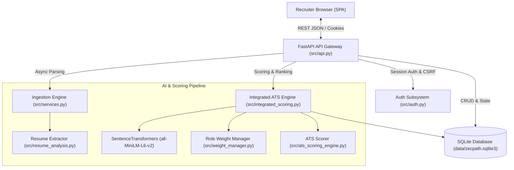

# Day 20 – ATS System Architecture & Component Topology

## 1. Architectural Overview

The **ZecPath Applicant Tracking System (ATS)** subsystem is integrated directly into the monolithic root application (`src/main.py`), avoiding fragmented microservices or brittle out-of-process IPC. It orchestrates candidate resume ingestion, section extraction, skill matching, neural semantic similarity, and human-in-the-loop candidate ranking.

---

## 2. Component Inventory

| Component | File Path | Primary Responsibilities |
|---|---|---|
| **Root Application** | `src/main.py` | FastAPI application initialization, Starlette telemetry middleware, lifespan hooks, database setup. |
| **REST Router** | `src/api.py` | Over 50 authenticated endpoints organized under `/api/v1` handling job openings, candidates, and scoring. |
| **Recruiter Auth** | `src/auth.py` | PBKDF2-HMAC-SHA256 password hashing, 8-hour HTTP-only session cookies, same-origin CSRF verification. |
| **Relational Database** | `src/database.py` | SQLite schema management, foreign key enforcement, thread-safe connection pooling, schema migrations. |
| **Resume Analysis** | `src/resume_analysis.py` | Regex section parsing (Skills, Experience, Education), personal attribute masking, experience date calculation. |
| **Semantic Matching** | `day12_semantic_matching/` | Local SentenceTransformers (`all-MiniLM-L6-v2`) generating 384-dimensional dense embeddings and cosine similarity. |
| **ATS Scoring Engine** | `src/ats_scoring_engine.py` | Normalizes 4 evaluation components into $0-100\%$, computes weighted sum, classifies qualitative bands. |
| **Weight Manager** | `src/weight_manager.py` | Stores and validates role-specific weights ensuring sum strictly equals $1.0$. |
| **Frontend Dashboard** | `static/index.html` | Vanilla HTML5/CSS3/JavaScript single-page recruiter workspace with real-time KPI and candidate management. |

---

## 3. Data Flow & Security Boundaries

1. **Session Protection:** All mutating endpoints (`POST`, `PUT`, `PATCH`, `DELETE`) require a valid `zecpath_session` cookie AND an explicit same-origin request header (`Origin`), preventing Cross-Site Request Forgery (CSRF).
2. **Input Sanitization & De-identification:** Contact details (phone, email, postal address) and protected demographic markers are stripped before generating neural embeddings in `src/resume_analysis.py`.
3. **Auditability:** Every ATS score calculation persists an immutable evidence record containing matched skills, missing skills, raw component scores, and the exact timestamp.

