# Day 56: Full System Simulation – End-to-End Test Report

## 1. Objective
Validate the end-to-end ZecPath hiring pipeline (`SystemSimulationPipeline` in `src/simulation_pipeline.py`) across 4 synthetic candidate profiles and compare AI scores/recommendations against independent human reviewer rubrics.

## 2. Pipeline Flow Diagram

```mermaid
flowchart LR
    J[Job Setup] --> C[Candidate Registration]
    C --> R[Resume Attachment]
    R --> A[ATS Scoring]
    A --> E[Eligibility Check]
    E --> S[HR Screening]
    S --> H[HR Interview]
    H --> T[Technical Interview]
    T --> M[Machine Test]
    M --> CR[Day 51 Cross-Round Aggregation]
    CR --> FR[Day 52 Final Recommendation]
    FR --> RP[Day 53 Hiring Report]
    RP --> HD[Human Recruiter Decision]
```

## 3. Measured Simulation & AI-vs-Human Comparison (`day56_ai_vs_human_comparison.json`)
- **Total Evaluated:** 4 synthetic candidates (`Arun Kumar (Sim)`, `Rahul Menon (Sim)`, `Anjali Nair (Sim)`, `Neha Thomas (Sim)`)
- **Decision Alignment Rate:** `75.0%` (3/4 aligned)
- **Average Score Gap:** `2.65` points (Max gap: `5.6` points)
- **Controlled Discrepancy Case:** `cand_ffe1cb5e0e41` (`Neha Thomas (Sim)`) — AI recommended `SELECTED` (`87.6`) whereas human reviewer concluded `HOLD_REVIEW` (`82.0`) to request extra domain SQL verification.
- **Safeguard:** Human review remains mandatory; automatic rejection is disabled.

## 4. Verification & Evidence
- Unit & API Tests: `day56_full_system_simulation/tests/test_day56.py` (9 passed) + `tests/test_day53_day60.py` (`test_day56_system_simulation_pipeline`, `test_day56_ai_vs_human_comparison` passed).
- Screenshots: `day56_full_system_simulation/screenshots/` (`01`–`06`).
