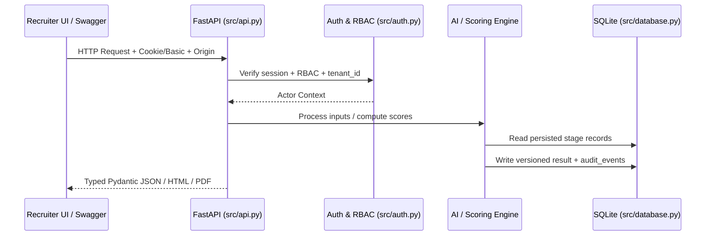

# Day 59: AI & Backend API Integration Architecture

## 1. Verified Core APIs (`src/api.py`, mounted at `/api/v1`)
| Feature | Method & Endpoint | Auth & Permission | Processing Mode | DB Tables |
|---|---|---|---|---|
| Resume Upload & Parsing | `POST /api/v1/resumes/upload` | `require_recruiter` | **Async (`202` + `processing_jobs`)** | `processing_jobs`, `candidates` |
| ATS Scoring | `POST /api/v1/candidates/{id}/score` | `require_recruiter` | Sync | `candidates` |
| Candidate Screening | `POST /api/v1/screening/sessions`, `POST .../answers` | `require_recruiter` | Sync (API-only) | `screening_sessions`, `screening_answers`, `screening_aggregate_scores` |
| HR Interview | `POST /api/v1/hr-interviews`, `POST .../respond` | `require_recruiter` | Sync (API-only) | `hr_interview_sessions`, `hr_interview_responses`, `hr_interview_scores` |
| Technical Interview | `POST /api/v1/technical-interviews`, `POST .../submit` | `require_recruiter` | Sync (API-only) | `technical_interview_sessions`, `technical_interview_responses` |
| Cross-Round Evaluation | `POST /api/v1/candidates/{id}/cross-round-evaluation` | `require_permission("score_candidate")` | Sync | `cross_round_evaluations`, `role_weight_configurations` |
| Final Recommendation | `POST /api/v1/candidates/{id}/final-recommendation` | `require_permission("score_candidate")` | Sync | `final_recommendations`, `role_decision_thresholds` |
| Recruiter Decision | `POST /api/v1/final-recommendations/{id}/decision` | `require_permission("make_recommendation_decision")` | Sync | `final_recommendations`, `recommendation_decision_history`, `audit_events` |

## 2. Data Flow Diagram

## 3. Sync vs Async Evaluation
- **Async Implemented:** `POST /api/v1/resumes/upload` queues a background task (`202 Accepted`) tracked via `GET /api/v1/jobs/{job_id}`.
- **Sequential Chunking:** `POST /api/v1/resumes/batch-process` is `async def` but iterates items sequentially inside chunks.
- **Sync:** Interview evaluations, cross-round aggregation, recommendations, and reports run synchronously with sub-50ms DB latency.

## 4. Verification & Evidence
- `day59_api_integration_planning/tests/test_day59.py` (17 passed)
- Screenshots: `day59_api_integration/screenshots/` (`01_swagger_cross_round_api.png`, `02_swagger_hiring_report_api.png`, `03_day59_api_integration_tests_terminal.png`).
