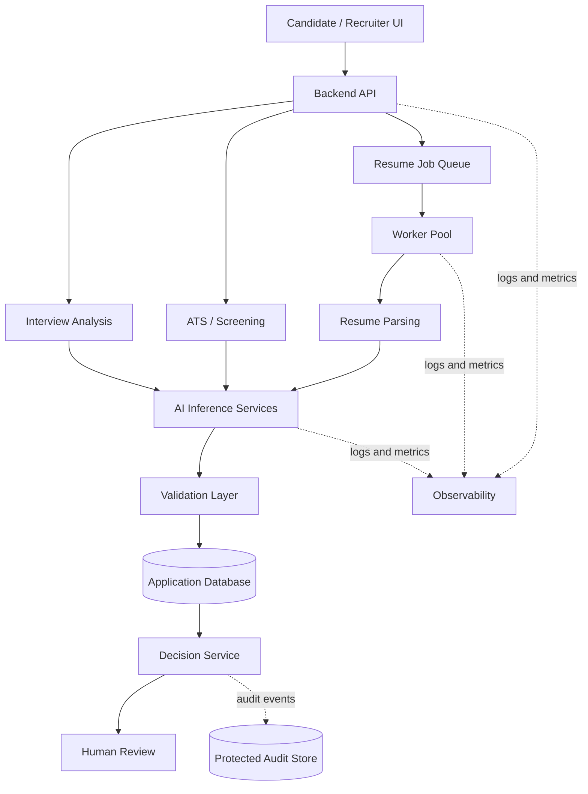

# System Architecture Documentation

## Logical architecture

## Responsibilities
- UI: submit/view candidate workflow information and support recruiter review.
- Backend API: authentication, authorization, validation, orchestration.
- Queue/workers: decouple submissions from slower tasks; use bounded concurrency and safe retries.
- Resume parser: extract text/fields from supported documents.
- AI inference: execute configured model tasks and return structured outputs.
- Validation: check schema, required fields, and business rules.
- Database: persist workflow state and validated results.
- Decision service: record a recommendation/status under approved policy.
- Human review: inspect evidence and record an authorized outcome.
- Observability: logs, metrics, traces, alerts.
- Audit store: protected decision provenance.

This is a logical reference, not proof of separate production services. Verify actual topology in the repository.

## Request lifecycle
1. Authenticate and validate the request.
2. Validate file and metadata.
3. Create processing job.
4. Extract document content.
5. Run model/scoring task.
6. Validate and normalize output.
7. Persist result and provenance.
8. Present for human review.
9. Record audit and telemetry events.

## Resilience and scaling
Use timeouts, bounded retries for transient failures, idempotency for retried writes, dead-letter handling in production, stateless API replicas, worker scaling based on queue age/depth, and cache invalidation tied to model/config versions.
