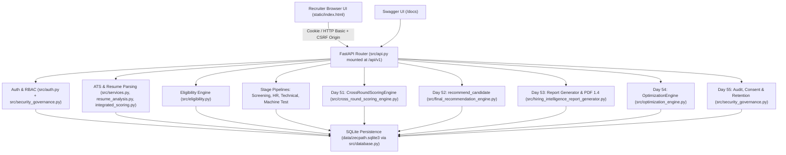

# ZecPath AI Hiring System – Complete Project Workflow & Implementation Summary

## 1. Project Introduction & Problem Statement
The **ZecPath AI Hiring System** is an end-to-end, local-first recruitment intelligence platform built on FastAPI, SQLite, and a vanilla HTML/JS recruiter workspace. Modern technical hiring spans resume screening, eligibility filtering, conversational screening, HR interviews, technical interviews, coding machine tests, integrity/behavioral advisories, and final offer decisions. Without unified persistence and governance, scores become fragmented, missing rounds are silently penalized, and AI outputs lack human accountability.

## 2. Project Objectives
1. Provide a persistent, local-first ATS and multi-round hiring evaluation backend (`FastAPI` + `SQLite`).
2. Extract structured resume evidence (skills, experience, education) and score candidate-job alignment transparently.
3. Enforce deterministic, rule-based mandatory eligibility checks (`ELIGIBLE`, `REVIEW`, `REJECTED`).
4. Support multi-stage assessments (Screening, HR Interview, Technical Interview, Machine Test) with non-punitive integrity and behavioral advisories.
5. Aggregate all 5 rounds with role-specific weights and missing-stage renormalization (Day 51), produce explainable hybrid recommendations (Day 52), generate 14-section JSON/HTML/Markdown/PDF reports (Day 53), calibrate thresholds on synthetic validation data (Day 54), and enforce RBAC, tenant isolation, consent, retention, and tamper-evident audit logging (Day 55).

---

## 3. Complete System Architecture



### Frontend Architecture
- Single-page vanilla HTML/CSS/JS workspace at `static/index.html` served by `src/main.py` at `/`.
- Uses `const api = "/api/v1";` and HTTP-only session cookie (`zecpath_session`) with automatic health polling (`GET /api/v1/health`).
- Contains 6 tabs inside `#workspace`:
  1. `ATS & Candidates` (job openings, candidate creation, resume upload, ATS scoring, eligibility config & evaluation, shortlisting, system observability)
  2. `Day 51: Cross-Round Evaluation`
  3. `Day 52: Recommendation Review`
  4. `Day 53: Hiring Intelligence Report`
  5. `Day 54: Optimization Analytics`
  6. `Day 55: Security & Governance`

### Backend & Database Architecture
- **Entrypoint:** `src/main.py` (`app` FastAPI instance, `observability_middleware`, lifespan calling `database.initialize_database()`, mounts `system_router` and `router` under `/api/v1`).
- **Persistence:** `src/database.py` manages SQLite (`data/zecpath.sqlite3` or `ZECPATH_DB_PATH` override) with `PRAGMA foreign_keys = ON` and schema migrations.
- **Core Tables:** `openings`, `candidates`, `processing_jobs`, `recruiter_accounts`, `recruiter_sessions`, `recruiter_login_attempts`, `eligibility_configurations`, `eligibility_evaluations`, `screening_sessions`, `screening_aggregate_scores`, `hr_interview_sessions`, `hr_interview_scores`, `technical_interview_sessions`, `machine_test_assignments`, `machine_test_submissions`, `candidate_integrity_records`, `candidate_behavioral_records`, `role_weight_configurations`, `cross_round_evaluations`, `role_decision_thresholds`, `final_recommendations`, `recommendation_decision_history`, `hiring_intelligence_reports`, `optimization_runs`, `candidate_consents`, `retention_policies`, `audit_events`.

---

## 4. End-to-End Hiring Workflow (Steps 1–14)

| Step | Stage | Engine / Module | Key DB Tables | Endpoints | UI / API Status |
|---|---|---|---|---|---|
| 1 | Recruiter Login & Dashboard | `src/auth.py` (`verify_recruiter_credentials`, `require_recruiter_context`) | `recruiter_accounts`, `recruiter_sessions`, `recruiter_login_attempts` | `POST /api/v1/auth/session`, `GET /api/v1/auth/session`, `DELETE /api/v1/auth/session` | **Browser UI + API** |
| 2 | Job Creation & Config | `src/job_description_parser.py`, `src/database.py` | `openings`, `eligibility_configurations` | `POST /api/v1/openings`, `PATCH /api/v1/openings/{id}`, `PUT /api/v1/openings/{id}/eligibility-config` | **Browser UI + API** |
| 3 | Resume Upload & ATS | `src/resume_analysis.py`, `src/services.py`, `src/integrated_scoring.py` | `candidates`, `processing_jobs` | `POST /api/v1/candidates/{id}/resume`, `POST /api/v1/candidates/{id}/score`, `GET /api/v1/openings/{id}/shortlist` | **Browser UI + API** |
| 4 | Eligibility Engine | `src/eligibility.py` (`evaluate_eligibility`) | `eligibility_evaluations` | `POST /api/v1/candidates/{id}/eligibility` | **Browser UI + API** |
| 5 | Candidate Screening | `src/screening_pipeline.py`, `src/screening_questions.py`, `src/screening_scoring_integration.py` | `screening_sessions`, `screening_answers`, `screening_aggregate_scores`, `screening_reports_full` | `/api/v1/screening/*` | **API-only** (Recruiter UI shows report summary) |
| 6 | HR Interview | `src/hr_interview_engine.py`, `src/hr_interview_pipeline.py`, `src/hr_scoring_engine.py` | `hr_interview_sessions`, `hr_interview_questions`, `hr_interview_responses`, `hr_interview_scores` | `/api/v1/hr-interviews/*` | **API-only** |
| 7 | Technical Interview | `src/technical_interview_engine.py`, `src/technical_scoring_engine.py` | `technical_interview_sessions`, `technical_interview_questions`, `technical_interview_responses` | `/api/v1/technical-interviews/*` | **API-only** (Recruiter UI has expandable summary) |
| 8 | Behavioral & Integrity | `src/integrity_engine.py`, `src/behavioral_ai_engine.py` | `candidate_integrity_records`, `candidate_behavioral_records` | `/api/v1/candidates/{id}/integrity`, `/api/v1/candidates/{id}/behavioral` | **API + Report/Recommendation integration** |
| 9 | Machine Test | `src/machine_test_engine.py` | `machine_test_assignments`, `machine_test_submissions` | `/api/v1/machine-tests/*` | **API-only** (AST/static validation only; **no OS/container sandbox**) |
| 10 | Day 51 Cross-Round Aggregation | `src/cross_round_scoring_engine.py` (`CrossRoundScoringEngine`) | `role_weight_configurations`, `cross_round_evaluations` | `GET/PUT /api/v1/role-weights`, `POST/GET /api/v1/candidates/{id}/cross-round-evaluation` | **Browser UI + API** |
| 11 | Day 52 Final Recommendation | `src/final_recommendation_engine.py` (`recommend_candidate`) | `role_decision_thresholds`, `final_recommendations`, `recommendation_decision_history` | `GET/PUT /api/v1/decision-thresholds`, `POST/GET /api/v1/candidates/{id}/final-recommendation`, `POST /api/v1/final-recommendations/{id}/decision` | **Browser UI + API** |
| 12 | Day 53 Hiring Intelligence Report | `src/hiring_intelligence_report_generator.py` (`generate_candidate_hiring_report`, `render_report_pdf`) | `hiring_intelligence_reports` | `POST/GET /api/v1/candidates/{id}/hiring-intelligence-report`, `/html`, `/markdown`, `/pdf` | **Browser UI + API + Chrome PDF** |
| 13 | Day 54 Optimization | `src/optimization_engine.py` (`run_full_optimization_analysis`) | `optimization_runs` | `POST /api/v1/optimization/run`, `GET /api/v1/optimization/history`, `GET /api/v1/monitoring/dashboard` | **Browser UI + API** |
| 14 | Day 55 Security & Governance | `src/security_governance.py`, `src/auth.py` | `candidate_consents`, `retention_policies`, `audit_events` | `/api/v1/governance/*`, `/api/v1/candidates/{id}/consent`, `/api/v1/audit/events`, `/api/v1/audit/verify` | **Browser UI + API** |

---

## 5. Deep Dive: Days 51–55 Calculation, Decision, Optimization & Governance

### Day 51: Unified Scoring Calculation
- Reads persisted scores from `candidates.score`, `screening_aggregate_scores`, `hr_interview_scores`, `technical_interview_sessions`, and `machine_test_submissions`.
- Assigns explicit `stage_status` (`COMPLETED`, `PENDING`, `NOT_STARTED`, `NOT_APPLICABLE`). Missing/pending stages are **excluded** rather than scored as `0`.
- Remaining weights are renormalized proportionally (`effective_weights`) so `hiring_fit_percentage` stays calibrated on `0–100%`.
- Example (`cand_arun_kumar`, `python_developer` weights `15/15/15/30/25`):
  - `91*0.15 + 88*0.15 + 86*0.15 + 90*0.30 + 92*0.25 = 89.75%`.
- Example (`cand_vivek_raj`, `machine_test = PENDING`, 4/5 stages):
  - Remaining weights `15+15+15+30 = 75` renormalize to `20%/20%/20%/40%` -> `81.40%`.

### Day 52: Final Recommendation Logic
- Combines unified score, stage completeness (`completed_rounds`), `eligibility_status`, and non-punitive risk flags (`integrity`, `behavior`).
- Confidence (`0–100`) = `Coverage (50%) + Evidence Quality (30%) + Data Consistency (20%)`.
- **Mandatory Eligibility Override:** `eligibility_status == "REJECTED"` forces `decision = "REJECTED"` (`MANDATORY_ELIGIBILITY_FAILED`) regardless of score (verified on `cand_anjali_nair`, score `81.90%`).
- **Incomplete Round Gate:** Incomplete assessments (`< 4` rounds or `confidence < 75`) route to `HOLD_REVIEW` (verified on `cand_vivek_raj`).
- **Non-Punitive Risk Flags:** Integrity/behavioral flags never auto-reject; they require human review.

### Day 53: Report Generation & Deterministic PDF Export
- `generate_candidate_hiring_report()` queries actual persisted stage records and produces a versioned report without inventing scores for missing stages.
- `render_report_pdf()` generates deterministic multi-page PDF 1.4 bytes without external native PDF dependencies.

### Day 54: Optimization & Synthetic Validation
- Evaluates thresholds against `day54_optimization_refinement/data/labelled_evaluations.json` (12 labelled synthetic cases).
- **Important Distinction:** Metrics (`Accuracy 91.7%`, `Precision 75.0%`, `Recall 100.0%`, `F1 85.7%` at `selected_min=80.0`) measure consistency on the **synthetic validation dataset** and do not prove real-world hiring accuracy.

### Day 55: Security, RBAC, Tenant Isolation & Audit Chain
- **Authentication:** PBKDF2-SHA256 (`600,000` iterations, 16-byte salt), HTTP-only `zecpath_session` cookie (8-hour lifetime) + HTTP Basic Auth, CSRF origin validation, and rate limiting (`recruiter_login_attempts`).
- **RBAC Roles:** `recruiter`, `senior_recruiter`, `admin`, `auditor` enforced via `require_permission(action)` in `src/api.py`.
- **Tenant Isolation:** Openings, candidates, evaluations, recommendations, and reports carry `tenant_id`; cross-tenant requests return `HTTP 403` (except read-only `auditor`).
- **Tamper-Evident Audit:** `audit_events` chains `previous_hash -> event_hash` via SHA-256; direct SQLite tampering is detected by `GET /api/v1/audit/verify` (`verified: false`).

---

## 6. Known Limitations & API-Only Features
1. **API-Only Assessment Portals:** Candidate-facing Screening, HR Interview, Technical Interview, and Machine Test submission portals are backend APIs only; no candidate-facing UI pages exist in `static/index.html`.
2. **Machine Test Execution:** Uses AST/static analysis and test-case evaluation in Python; **OS/container sandbox isolation is NOT implemented**.
3. **Behavioral / Integrity Safeguards:** Emotion/gaze/nervousness detection is intentionally not used as a hiring score.

---

## 7. How to Run, Seed, Log In & Test (VS Code / PowerShell)

1. **Seed Demo Data (idempotent):**
   ```powershell
   python scripts/seed_days51_55_demo_data.py
   ```
2. **Start FastAPI Backend & Frontend (served together at `/`):**
   ```powershell
   python -m uvicorn src.main:app --host 127.0.0.1 --port 8000
   ```
3. **Open in Browser:**
   - Recruiter Workspace: `http://127.0.0.1:8000`
   - Swagger API Docs: `http://127.0.0.1:8000/docs`
4. **Development Demo Credentials:**
   - Admin Recruiter (`default_tenant`): `recruiter-d41-52` / `Password123!LongEnough`
   - Junior Recruiter (`recruiter` role, `default_tenant`): `junior_recruiter` / `JuniorDemo123!`
   - Tenant B Admin (`tenant_b`): `tenant_b_recruiter` / `TenantBDemo123!`
5. **Run Full Test Suite (using isolated temp DB so demo DB is preserved):**
   ```powershell
   $env:ZECPATH_DB_PATH="$env:TEMP\zecpath_test.sqlite3"
   python -m pytest day51_cross_round_aggregation_engine/tests/ day52_final_recommendation_ai/tests/ day53_hiring_intelligence_report/tests/ day54_optimization_refinement/tests/ day55_security_ai_governance/tests/ tests/test_day51_55_comprehensive.py tests/test_api.py tests/test_day41_day52.py tests/test_day53_day60.py -v
   ```
