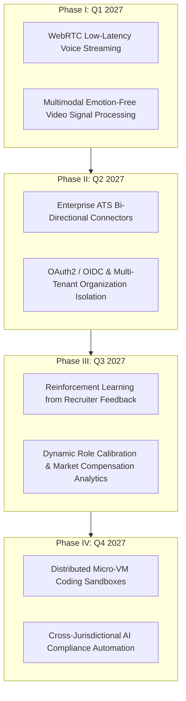

# ZecPath AI Hiring System — Long-Term Technical & AI Roadmap (2027+)

**Document Version:** 2.0.0  
**Status:** Post-Day 70 Strategic Technical Roadmap  
**Target Horizon:** 2027 – 2028  
**Architecture Focus:** Scalability, Multimodal Audio, Continuous Learning & Enterprise Ecosystem  

---

## 1. Executive Vision

Over the initial 70-day engineering program, the ZecPath AI Hiring System evolved from an experimental resume parser into a comprehensive, multi-stage recruitment intelligence platform. The system successfully unified resume ingestion, 4-factor ATS scoring, conversational screening, adaptive HR interviewing, technical depth evaluation, machine coding assessments, cross-round synthesis, cryptographic audit trails, and real-time observability.

The **2027+ Strategic Roadmap** defines the next evolution: transitioning ZecPath from an air-gapped single-node deployment into an enterprise-scale, multimodal, continuous-learning talent acquisition platform.

---

## 2. Multi-Phase Technical Roadmap (2027)

---

## 3. Phase-by-Phase Architectural Initiatives

### Phase I (Q1 2027): Real-Time Multimodal Voice & Streaming
* **Current State:** Candidate audio is recorded and processed in chunked segments using local STT inference.
* **Target Architecture:**
  * **Bidirectional WebRTC Streaming:** Implement full-duplex WebRTC audio streaming to achieve sub-200ms latency during conversational screening.
  * **Streaming VAD (Voice Activity Detection):** Natural turn-taking detection using Silero VAD to eliminate unnatural speech delays.
  * **Multimodal Non-Invasive Video Analysis:** Optional candidate video stream processing focused purely on professional environment quality, gaze engagement, and presentation pacing — strictly maintaining the **zero facial emotion classification** ethical policy.

### Phase II (Q2 2027): Enterprise ATS Ecosystem & Multi-Tenancy
* **Current State:** Localhost web dashboard with SQLite persistence and standalone REST API.
* **Target Architecture:**
  * **Enterprise ATS Connectors:** Native bi-directional webhook and API synchronizers for:
    * Greenhouse Harvest API & Webhooks
    * Workday Recruiting REST APIs
    * Lever Postings & Candidate Opportunities API
    * Ashby Webhook Integrations
  * **Multi-Tenant Architecture:** Migrate from single-tenant SQLite to distributed PostgreSQL with schema-level tenant isolation, row-level security (RLS), and organization-specific role-based access control (RBAC).
  * **Enterprise SSO:** SAML 2.0 and OIDC integrations supporting Okta, Microsoft Azure AD / Entra ID, and Google Workspace SSO.

### Phase III (Q3 2027): Active Learning & Recruiter Feedback Loops (RLHF)
* **Current State:** Rule-bounded and static rubric evaluation with fixed weight configurations.
* **Target Architecture:**
  * **Recruiter Preference Optimization:** Safely capture anonymized recruiter approval, hold, and override actions to continuously fine-tune the cross-round recommendation engine.
  * **Dynamic Weight Auto-Tuning:** Suggest personalized stage weights based on historical correlation between evaluation scores and subsequent employee 90-day retention and performance reviews.
  * **Explainability Distillation:** Train lightweight, interpretable surrogate models that automatically draft executive summary justifications in the recruiter's natural organizational tone.

### Phase IV (Q4 2027): Distributed Code Sandboxing & Global Compliance
* **Current State:** Coding tests execute against local Python assertions in sandboxed processes.
* **Target Architecture:**
  * **Firecracker Micro-VM Execution:** Execute machine coding tests inside ephemeral, isolated micro-virtual machines (Firecracker / gVisor) supporting 25+ programming languages (Python, Go, Java, TypeScript, Rust, C++, C#).
  * **Interactive Debugging Interviews:** Live collaborative pair-programming environments with real-time terminal synchronization and playback audit trails.
  * **Automated Compliance Engine:** Real-time generation of NYC Local Law 144 independent audit reports, EU AI Act conformity assessments, and EEOC adverse impact ratio calculation dashboards.

---

## 4. Ethical AI & Governance Commitments

Across all future roadmap initiatives, ZecPath will strictly adhere to our core founding governance principles:

1. **Non-Delegable Human Primacy:** The AI engine recommends; human recruiters decide. Automated candidate rejections remain strictly prohibited.
2. **Deterministic & Decomposed Scoring:** No proprietary black-box composite scores. Every score must be mathematically decomposable into verifiable evidence.
3. **Candidate Privacy by Design:** Raw candidate data remains protected under strict data sovereignty; telemetry logs must never ingest PII or biometric identifiers.
4. **Candidate Developmental Empowerment:** Every candidate who completes an assessment receives actionable, personalized coaching suggestions and practice resources, regardless of the final hiring outcome.
