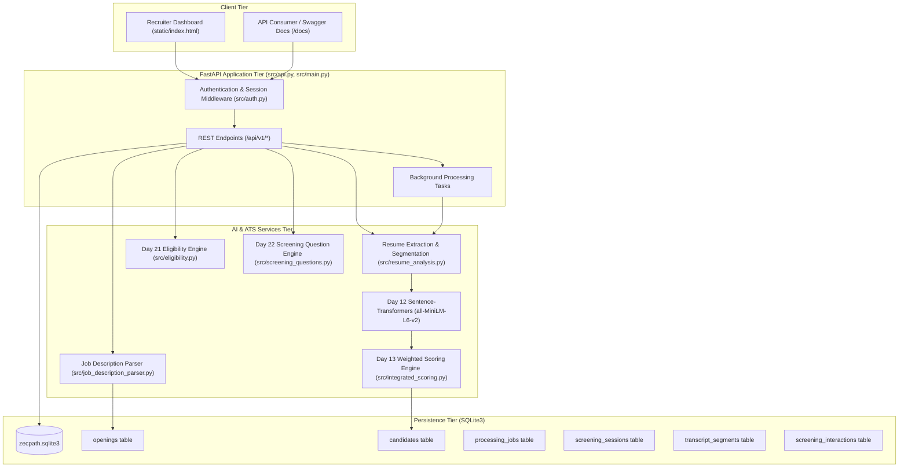
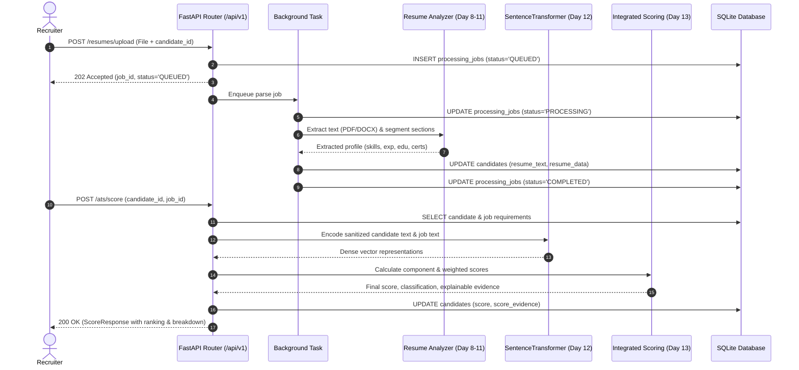
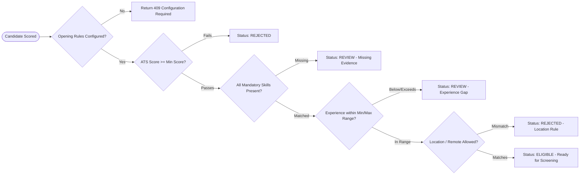

# Day 19 — ATS Architecture Diagrams & System Topology

This document visualizes the complete system architecture, data flow, API lifecycle, scoring pipeline, ranking, and asynchronous processing models of the integrated ZecPath ATS subsystem.

---

## 1. Overall System Architecture

---

## 2. Resume Processing & Scoring Lifecycle

---

## 3. Eligibility Decision Flow

