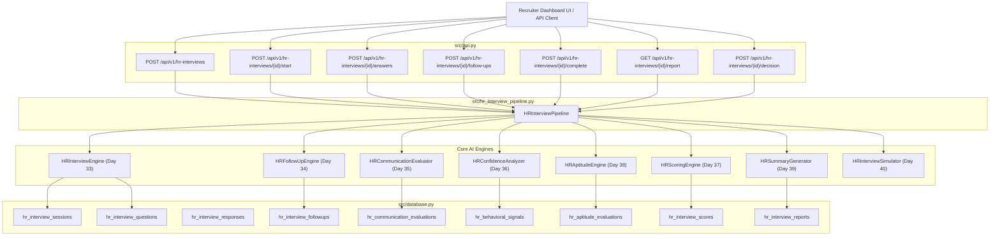

# Days 33–40: End-to-End System Architecture

## 1. Architectural Overview

## 2. Core Separation of Responsibilities
1. **ATS Document Processing (Days 1–23):** Parses resumes, extracts sections, executes semantic embedding match against job requirements.
2. **Screening Subsystem (Days 24–32):** Handles initial audio transcription, speech-to-text, and threshold eligibility rules.
3. **HR Interview Subsystem (Days 33–40):** Handles multi-turn interview dialogue, behavioral probing, communication nuance, aptitude, and executive recruiter dossiers.

