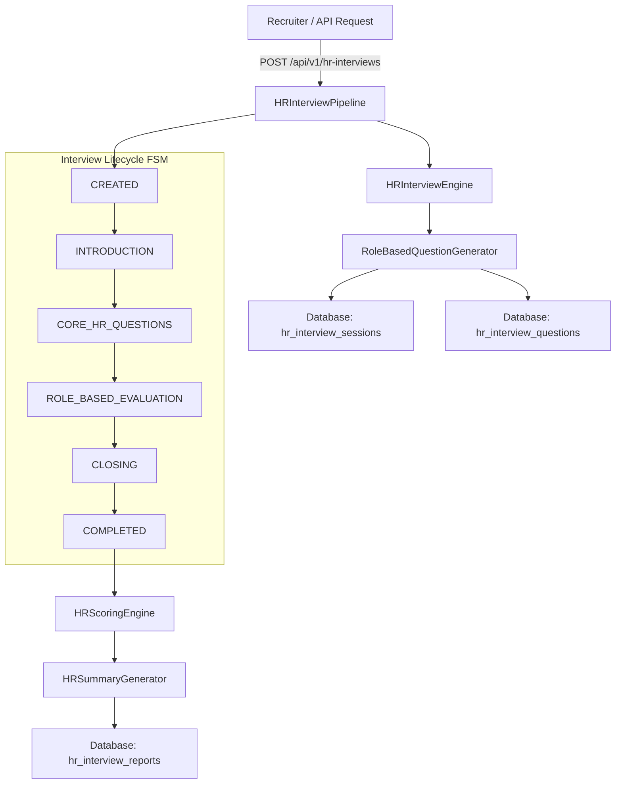

# Day 33: HR Interview Architecture & State Machine

## 1. System Architecture Diagram

## 2. Key Architecture Principles
1. **Additive Schema:** Operates entirely independently from `screenings` and `candidates` ATS resume scores.
2. **Deterministic State Machine:** Guarantees candidates cannot skip stages or modify completed interview records.
3. **Idempotent Storage:** Question sets are bound to `interview_id` and frozen at session creation.

