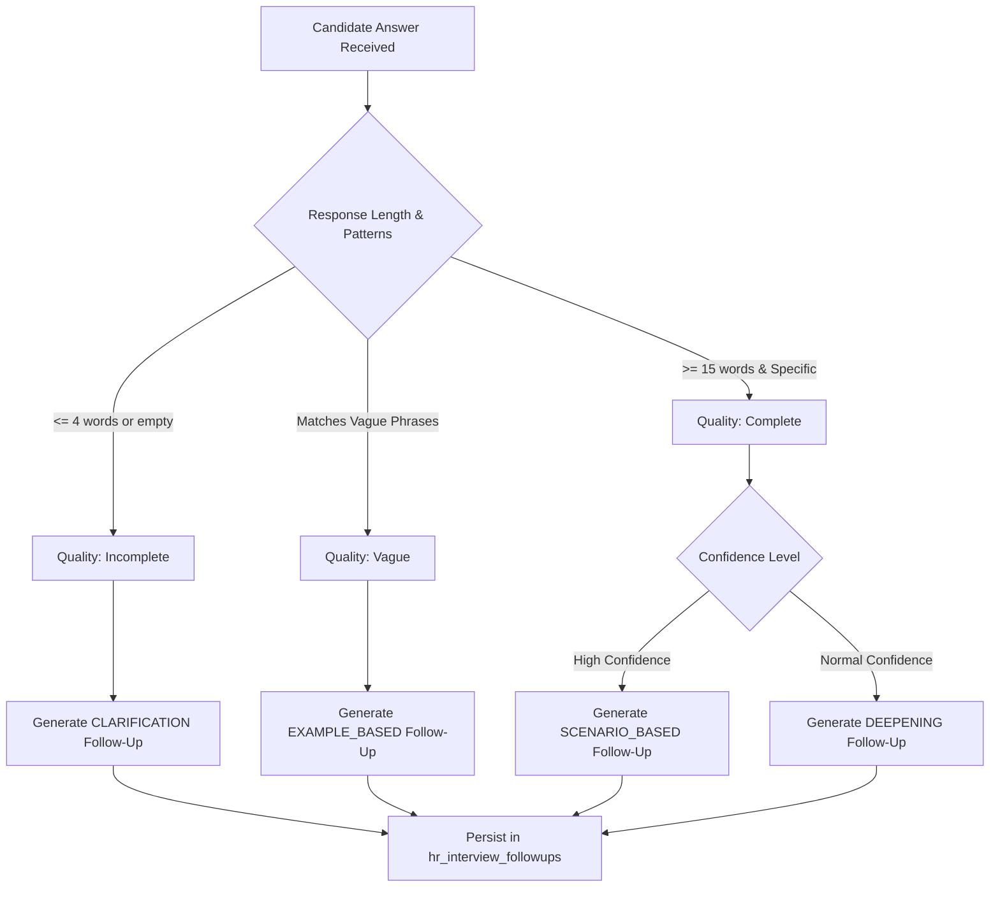

# Day 34: Dynamic Follow-Up Logic & Adaptive Questioning Engine

## 1. Overview
The Adaptive Questioning Engine dynamically evaluates the quality, completeness, and confidence of a candidate's answer in real time, determining whether a targeted follow-up question is warranted.

---

## 2. Follow-Up Decision Tree

---

## 3. Adaptation Strategies
- **Clarification:** Prompted when responses fail minimum substance thresholds (e.g. "Could you elaborate on that and explain what steps you took?").
- **Example-Based:** Prompted when candidates make general claims without concrete evidence (e.g. "Could you provide a specific example from your experience to illustrate that point?").
- **Deepening / Scenario-Based:** Prompted on comprehensive, confident responses to probe edge cases, trade-offs, and critical decision points.
- **Repetition Prevention:** Enforces a hard limit of one adaptive follow-up per parent question to keep interviews structured and time-efficient.

