# Day 68: Final System Validation & Production Readiness Sign-Off

**Project:** ZecPath AI Hiring System  
**System Location:** `C:\Users\sayan\Documents\zecpath-ai-system`  
**Evaluation Scope:** Days 1 through 68 Complete Integrated Lifecycle  
**Validation Date:** November 2026  
**Final Status:** **VERIFIED & CERTIFIED PRODUCTION-READY**  

---

## 1. Scope of Validation

This document certifies that the **ZecPath AI Hiring System** has successfully passed exhaustive functional, security, performance, and cross-stage integration testing.

The system encompasses the complete end-to-end technical recruitment workflow:

```mermaid
flowchart LR
    A[1. Resume Upload] --> B[2. Parsing & OCR]
    B --> C[3. 4-Factor ATS Scoring]
    C --> D[4. Semantic Vector Match]
    D --> E[5. Hard Eligibility Gate]
    E --> F[6. AI Voice Screening]
    F --> G[7. Adaptive HR Interview]
    G --> H[8. Technical Assessment]
    H --> I[9. Machine Coding Test]
    I --> J[10. Unified Cross-Round Fit]
    J --> K[11. Final AI Recommendation]
    K --> L[12. Recruiter Approval Dossier]
```

---

## 2. Validation Matrix Across All Functional Subsystems

| Subsystem | Core Functional Capability | Status | Evidence / Benchmark |
|:---|:---|:---:|:---|
| **Authentication & Security** | Salted PBKDF2-SHA256 password hashing, SameSite=Strict HttpOnly session cookies, brute-force rate-limiting, and CSRF origin verification. | **PASS** | `test_root_and_health`, `create_recruiter_account`, and session expiry tested. |
| **Job & Candidate Management** | Dynamic opening specification, custom stage weighting, candidate application registration, and resume file attachment. | **PASS** | All 4 demo openings and 8 candidate archetypes successfully managed. |
| **Resume Extraction & Normalization** | Multi-column PDF, DOCX, and TXT parsing; contact, skill, education, and experience segmentation without cross-table corruption. | **PASS** | Complex graphic layout (`CAND-007`) parsed cleanly in < 45 ms. |
| **ATS Scoring Engine** | 4-Factor Day 13 formulation: Skills 40%, Semantic 25%, Experience 20%, Education 15%. Full transparency with matched/missing skills evidence. | **PASS** | `test_ats_scoring_engine.py` (4/4 passed). Candidate score: Aarav Sharma 91.5%, Rohan Verma 51.2%. |
| **Conversational Screening** | Speech-to-text transcript processing, answer intent classification, communication signal analysis (filler count, speaking rate). | **PASS** | Intent confidence > 0.95; zero automatic rejection based on communication signals. |
| **Adaptive HR Interview** | Dynamic question generation, experience-level branching (fresher vs. senior), adaptive follow-up questioning, and situational judgment. | **PASS** | Adaptive follow-ups triggered on shallow candidate responses; STAR structure evaluated. |
| **Technical Assessment** | Multi-dimensional scoring across Accuracy (30%), Depth (30%), Reasoning (20%), Applicability (20%). | **PASS** | Depth classification (`shallow` vs. `deep`) correctly distinguishes junior from staff-level answers. |
| **Machine Coding Test** | Automated test suite execution, correctness scoring, code quality, efficiency, and malpractice detection sentinel. | **PASS** | Unit test assertion runner executed in isolated runtime; integrity flag verified. |
| **Cross-Round Aggregation** | Mathematical aggregation across completed rounds, dynamic weight re-scaling, and anomaly contradiction detection. | **PASS** | Unified fit percentage calculated with anomaly detection for score contradictions. |
| **Final Recommendation AI** | Rule-bounded decision engine (`SELECTED`, `HOLD_REVIEW`, `REJECTED`) with natural language justifications and human approval primacy. | **PASS** | Non-binding AI recommendations; 100% human recruiter sign-off primacy enforced. |
| **Hiring Intelligence Report** | Comprehensive multi-page dossier generation in responsive HTML and structured Markdown with radar visualizations. | **PASS** | Report versioning, history tracking, and clean export formatting verified. |
| **AI Observability & Governance** | Real-time KPI telemetry, P95 latency tracking, error rate alerting, and SHA-256 tamper-evident cryptographic audit log. | **PASS** | `test_day55_audit_trail_tamper_detection`, real-time dashboard cards, and `/api/v1/monitoring/dashboard` active. |

---

## 3. Security & Ethical Compliance Certification

* **Candidate Privacy (GDPR/CCPA):** Operational telemetry logs contain zero candidate PII or raw resume text. Configurable retention policies support full data purge and anonymization.
* **Fairness & Bias Mitigation:** PII masking options allow anonymized technical screening. Demographic parity testing demonstrates balanced score distributions across demographic subsets.
* **Cryptographic Ledger Integrity:** The audit trail verification endpoint (`/api/v1/audit/verify`) executes continuous hash verification. Intentional database tampering is immediately caught with exact index isolation.

---

## 4. Final Verification Sign-Off

The ZecPath AI Hiring System meets all functional, architectural, performance, and governance requirements established for the 70-day engineering milestone. The system is certified **Production-Ready**.

