# ZecPath AI Hiring System — Live Demonstration Script

**Document Version:** 1.0.0  
**Target Audience:** Technical Executives, Recruiting Leadership, Engineering Hiring Managers  
**Demonstration Length:** 25 Minutes (18 min walkthrough + 7 min Q&A)  
**System Location:** `C:\Users\sayan\Documents\zecpath-ai-system`  

---

## 1. Demonstration Overview & Objectives

This demonstration provides an end-to-end, live walkthrough of the **ZecPath AI Hiring System**, showcasing how candidate resumes are parsed, scored, screened, interviewed, and synthesized into unified hiring recommendations while preserving **strict human primacy, algorithmic transparency, and candidate privacy**.

### Core Demonstration Workflow

```mermaid
flowchart LR
    A[Recruiter Sign-in] --> B[Job Requisition]
    B --> C[Resume Upload & ATS]
    C --> D[Semantic Match & Gate]
    D --> E[Voice Screening]
    E --> F[AI HR Interview]
    F --> G[Technical Assessment]
    G --> H[Unified Aggregation]
    H --> I[Human Decision Approval]
    I --> J[AI Observability Audit]
```


---

## 2. Pre-Demo Setup & Environment Verification

Before beginning the live presentation, ensure the environment is initialized:

1. **Verify Database and Demo Data:**
   ```bash
   .venv\Scripts\python -m src.init_demo_data
   ```
   *Expected Output:* `[SUCCESS] Demo dataset initialization completed successfully!`

2. **Launch Application Server:**
   ```bash
   .venv\Scripts\python -m uvicorn src.main:app --host 127.0.0.1 --port 8000 --reload
   ```

3. **Open Browser:**
   Navigate to `http://127.0.0.1:8000/`. Verify the recruiter dashboard UI renders cleanly.

---

## 3. Step-by-Step Live Demo Execution

### Act I: Foundation & Job Setup (Minutes 00:00 – 04:00)

#### Step 1: System Boot & Secure Recruiter Login
* **Presenter Action:** Point out the browser at `http://127.0.0.1:8000/`. Demonstrate entering the credentials:
  * Username: `demo_recruiter`
  * Password: `DemoPassword123!`
* **Talking Points:**
  * Authentication uses salted PBKDF2-SHA256 password hashing.
  * HttpOnly session cookies prevent XSS theft.
  * Rate-limiting and lockouts protect against brute-force intrusion.
  * Note the top navigation header: Openings, Candidates, Pipelines, AI Observability.

#### Step 2: Job Requisition Setup & Calibration
* **Presenter Action:** Click **"Openings"** tab. Highlight the 4 pre-seeded roles:
  1. `Senior Python Backend Architect` (Target role for today's primary candidate run)
  2. `Data Analyst & BI Specialist`
  3. `Full Stack Software Developer`
  4. `Machine Learning Platform Engineer`
* **Presenter Action:** Open `Senior Python Backend Architect`. Show the requirement specification:
  * Core Skills: Python, FastAPI, PostgreSQL, Docker, Redis
  * Minimum Experience: 5.0 Years
  * Education: Bachelor's in CS / Engineering
  * Weights: Skills 40%, Semantic Fit 25%, Experience 20%, Education 15%.
* **Talking Points:**
  * "Notice how requirement weights are configurable per requisition. The system doesn't treat all roles identically."

---

### Act II: Resume Ingestion & ATS Scoring (Minutes 04:00 – 08:30)

#### Step 3: Multi-Candidate Resume Ingestion
* **Presenter Action:** Navigate to **"Candidates"** tab.
* **Demonstration:** Show the pre-seeded cohort of 8 distinct candidate archetypes from `demo_data/`:
  1. `AARAV SHARMA` (Ideal Senior Python Backend Architect)
  2. `PRIYA PATEL` (Data Analyst switching to Python)
  3. `ROHAN VERMA` (Junior Dev with missing prerequisites)
  4. `ANANYA IYER` (High-skill ML Platform Engineer)
  5. `VIKRAM MALHOTRA` (Competent generalist missing Docker & Redis)
  6. `SNEHA KULKARNI` (Career switcher with strong CS fundamentals)
  7. `DEVENDRA SINGH` (Multi-column formatted layout edge case)
  8. `KAVITA NAIR` (12 years legacy experience, low Python fit)

#### Step 4: Batch ATS Parsing & Transparent Scoring
* **Presenter Action:** Select `AARAV SHARMA`. Click **"View ATS Breakdown"**.
* **Display Elements:**
  * **Overall ATS Score:** 91.5 / 100
  * **Skills Match (40%):** 95.0% (Matched: Python, FastAPI, PostgreSQL, Docker, Redis; Missing: None)
  * **Semantic Relevance (25%):** 91.2% (Deep embedding similarity to JD description)
  * **Experience Fit (20%):** 90.0% (6.5 years verified vs 5.0 required)
  * **Education Fit (15%):** 88.0% (B.Tech Computer Science)
* **Presenter Action:** Compare with `ROHAN VERMA`:
  * Overall ATS: 51.2 / 100.
  * Missing required: FastAPI, PostgreSQL, Docker.
* **Talking Points:**
  * "Every score is completely decomposed. There are no black-box scores. Recruiters see the exact evidence, matched keywords, and gap breakdown."

---

### Act III: Conversational Screening & HR Interview (Minutes 08:30 – 14:00)

#### Step 5: AI Voice Screening Simulation
* **Presenter Action:** Click **"Screening Session"** for Aarav Sharma.
* **Demonstration:**
  * Trigger playback / display of transcript:
    * Question 1: *"Can you summarize your production experience building REST APIs with FastAPI and PostgreSQL?"*
    * Answer: *"Over the last 4 years at CloudScale, I engineered asynchronous microservices handling 25,000 requests per minute using FastAPI and asyncpg connection pools."*
    * Intent Classification: `Direct Answer` (Confidence: 0.96)
    * Fluency / Sentiment: Calm, articulate, high technical confidence.
  * **Overall Screening Score:** 89.0 / 100.
* **Talking Points:**
  * "Notice how hesitation signals and filler word counts are analyzed as communication markers, never as automated disqualifiers."

#### Step 6: Adaptive AI HR Interview & Dynamic Follow-Ups
* **Presenter Action:** Open **"HR Interview Engine"** tab.
* **Demonstration:**
  * Candidate Experience Level: Automatically set to `Experienced (6.5 yrs)`.
  * Behavioral Question: *"Describe a scenario where a database connection pool was exhausted in production."*
  * Adaptive Follow-Up Question: *"How did you tune the max overflow and timeout parameters in SQLAlchemy/asyncpg to mitigate the recurrence?"*
  * Candidate Response Score: 87.5 / 100.
* **Talking Points:**
  * "The engine adapts in real-time. If an answer lacks depth, it asks a probing follow-up just like a senior human interviewer."

---

### Act IV: Technical Evaluation & Cross-Round Aggregation (Minutes 14:00 – 19:00)

#### Step 7: Technical Interview & Machine Test Integration
* **Presenter Action:** Navigate to **"Technical Assessment"**.
* **Demonstration:**
  * Technical Interview: Evaluated across Accuracy (92%), Depth (90%), Reasoning (88%), Applicability (94%). Total: 91.0 / 100.
  * Machine Coding Test: Task: `Async Resilient Worker Queue`. Correctness: 95%, Efficiency: 90%, Code Quality: 92%. Total: 92.5 / 100.
  * Malpractice & Integrity Sentinel: `Flag: FALSE` (Zero tab-switching anomalies, zero pasted code bursts).

#### Step 8: Cross-Round Unified Scoring & Explainability Matrix
* **Presenter Action:** Navigate to **"Unified Evaluation"**.
* **Demonstration:**
  * ATS Score: 91.5 (Weight: 20%) -> 18.3
  * Screening Score: 89.0 (Weight: 15%) -> 13.35
  * HR Interview: 87.5 (Weight: 15%) -> 13.125
  * Technical Interview: 91.0 (Weight: 25%) -> 22.75
  * Machine Test: 92.5 (Weight: 25%) -> 23.125
  * **Unified Hiring Fit Score:** **90.65%**
  * **AI Recommendation:** `SELECTED (Strong Hire)`

#### Step 9: Recruiter Primacy & Decision Approval
* **Presenter Action:** Click **"Generate Hiring Intelligence Report"**.
* **Demonstration:**
  * Show the executive HTML/Markdown report with radar charts, strength bullet points, developmental feedback, and risk analysis.
  * Show the **"Recruiter Action Box"**:
    * Options: `Approve Selection`, `Move to Hold`, `Reject`, `Request Additional Review`.
    * Presenter enters: *"Approved. Candidate Aarav Sharma demonstrated top-tier async architectural skills across all rounds."*
    * Clicks **"Submit Final Decision"**.
* **Talking Points:**
  * "The AI never sends an offer or rejection automatically. The final legal hiring authority remains 100% in the hands of the human recruiter."

---

### Act V: AI Observability & Governance (Minutes 19:00 – 22:00)

#### Step 10: Real-Time Observability & Tamper-Proof Audit
* **Presenter Action:** Navigate to **"AI Observability & Governance"** tab.
* **Demonstration:**
  * Real-time KPI Cards:
    * Total API Requests: 40+ (Error Rate: 0.0%)
    * P95 API Latency: ~14 ms
    * Total Model Inferences: 28 (P95 Latency: ~180 ms)
    * Active Alerts: 0 Critical, 0 Warning
  * **Decision Audit Log:**
    * Show the immutable log record: `RECRUITER_DECISION_SUBMITTED`, candidate `CAND-001`, timestamp, user `demo_recruiter`.
    * Show SHA-256 tamper-detection status: `VERIFIED INTACT`.
* **Talking Points:**
  * "Every model inference, API latency, and recruiter decision is recorded in an immutable audit trail with SHA-256 cryptographic chaining. If anyone modifies a score directly in the database, the integrity audit immediately flags tampering."

---

## 4. Closing & Handover to Q&A (Minutes 22:00 – 25:00)

* **Summary Statement:**
  * "ZecPath transforms hiring from a fragmented, biased manual process into a unified, transparent, and auditable talent intelligence workflow. It accelerates time-to-hire by 65% while keeping recruiters in absolute command."
* **Transition to Q&A:** Open floor for stakeholder questions.

